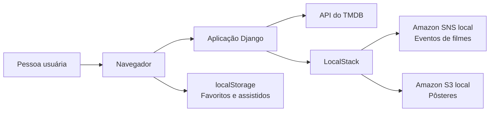

<div align="center">

# 🎬 CineScope

**Explore filmes. Encontre sua próxima história. Organize sua coleção.** 

Um catálogo web para descobrir filmes populares, pesquisar títulos e acompanhar seus favoritos e filmes assistidos.


</div>

## Sobre o projeto

O CineScope combina uma interface em português com dados de filmes fornecidos pelo [TMDB](https://www.themoviedb.org/). É também um projeto de estudo que reúne Django, integração com serviços externos e uma infraestrutura AWS simulada localmente com LocalStack.

## O que você pode fazer

- **Descobrir filmes populares** com pôsteres, títulos e sinopses.
- **Pesquisar por título** e navegar pelos resultados paginados.
- **Criar sua lista de favoritos** e remover filmes quando quiser.
- **Manter uma lista de filmes assistidos** diretamente pela página do catálogo.
- **Revisitar suas listas** em páginas dedicadas, com opção para remover itens.

## Como funciona



O projeto também inclui uma função Lambda de exemplo e configurações para execução local. Favoritos e assistidos ficam no `localStorage` do navegador: não exigem conta, mas também não são sincronizados entre dispositivos.

## Tecnologias

| Área | Tecnologias |
| --- | --- |
| Aplicação web | Python 3.10, Django, HTML, CSS e JavaScript |
| Catálogo | API do TMDB |
| Banco de dados | PostgreSQL 14 |
| Serviços AWS locais | LocalStack, boto3, S3, SNS e Lambda |
| Ambiente | Docker Compose |
| Testes | pytest e pytest-django |

## Executar localmente

### Pré-requisitos

- Docker com Docker Compose
- Acesso à API do TMDB para carregar o catálogo

### Iniciar os serviços

Configure o ambiente local exigido pela aplicação e pelo Docker Compose. Mantenha credenciais e configurações privadas fora do README e de commits.

Na raiz do projeto, execute:

```bash
docker compose up --build
```

Abra <http://localhost:8000> para acessar a aplicação. O Compose também inicia o PostgreSQL e o LocalStack para uso local.

### Executar os testes

Com as dependências instaladas e o ambiente de banco de dados configurado:

```bash
pytest
```

## Estrutura do projeto

```text
apps/catalog/          páginas, rotas e testes do catálogo
config/                configuração da aplicação Django
integrations/tmdb/     cliente da API do TMDB
integrations/aws/      integração local com S3 e SNS
infrastructure/        recursos locais e função Lambda de exemplo
static/js/              listas de favoritos e assistidos no navegador
```

## Escopo e observações

- As listas são armazenadas no navegador atual; limpar os dados do navegador pode removê-las.
- O PostgreSQL faz parte da infraestrutura do projeto, mas as listas pessoais não são persistidas nele.
- As integrações S3, SNS e Lambda são voltadas ao ambiente LocalStack; o projeto não configura por si só uma implantação em AWS.
- Os dados e pôsteres do catálogo são fornecidos pelo TMDB.
